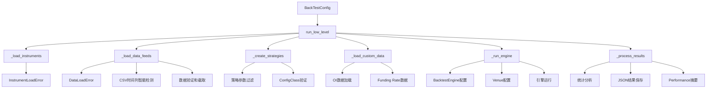

# Engine Low 重写计划

## 🎯 项目目标

将 [`backtest/engine_low.py`](backtest/engine_low.py) 重写为与 [`backtest/engine_high.py`](backtest/engine_high.py) 同等功能和质量的低级引擎实现，保持 BacktestEngine 直接 API 的特性，同时引入高级引擎的所有优化和功能。

## 📊 架构对比分析

### 当前 engine_low.py 的问题

- ❌ **异常处理缺失**: 无统一异常体系，错误处理简陋
- ❌ **数据加载脆弱**: 时间列处理不灵活，缺少数据验证
- ❌ **多标的支持不完整**: 逻辑分散，未完全实现多标的配置
- ❌ **无自定义数据**: 缺少 OI/Funding Rate 数据加载
- ❌ **结果处理简陋**: 仅生成 HTML 报告，无 JSON 统计和分析
- ❌ **用户体验差**: 无进度显示，错误信息不友好
- ❌ **内存管理缺失**: 无垃圾回收和引擎资源清理
- ❌ **类型提示不完整**: 缺少现代 Python 类型注解

### 目标架构设计



## 🔧 核心重写模块

### 1. 异常处理系统升级

将引入完整的异常体系：
- [`BacktestEngineError`](backtest/exceptions.py:22): 基础异常类
- [`InstrumentLoadError`](backtest/exceptions.py:59): 标的加载异常  
- [`DataLoadError`](backtest/exceptions.py:40): 数据加载异常
- [`CustomDataError`](backtest/exceptions.py:97): 自定义数据异常
- [`ValidationError`](backtest/exceptions.py:145): 验证异常

### 2. 数据加载函数重写

重写 [`_load_data_for_feed()`](backtest/engine_low.py:34) 函数：
- **时间列智能检测**: 支持 "datetime" 和 "timestamp" 两种列名
- **数据验证**: 检查必需列、数据范围、格式正确性
- **错误处理**: 详细的错误信息和异常追踪
- **性能优化**: 使用 [`CSVBarDataLoader`](nautilus_trader/persistence/loaders.py) 高效加载

### 3. 多标的支持完善

参考 [`_load_instruments()`](backtest/engine_high.py:44) 实现：
- 支持 [`instruments`](config/definitions.py:209) 列表配置
- 完整的标的验证和加载
- 标的与数据流的智能匹配
- 错误容忍和报告

### 4. 自定义数据加载

集成 [`utils/oi_funding_adapter.py`](utils/oi_funding_adapter.py) 功能：
- OI 数据加载和验证
- Funding Rate 数据处理
- 数据时间戳对齐
- 与 OHLCV 数据合并

### 5. 策略配置和实例化

改进策略处理逻辑：
- 使用 [`filter_strategy_params()`](backtest/utils.py:74) 参数过滤
- 配置类验证和错误处理
- 多实例策略创建和管理
- 参数注入和验证

### 6. 结果处理系统

实现完整的结果分析：
- JSON 格式结果保存
- 性能指标计算和摘要
- 策略配置记录
- 交易统计和分析
- 兼容 AI 分析的数据结构

### 7. 用户体验改进

- 进度显示和状态输出
- 友好的错误消息
- 彩色输出和图标
- 操作时间统计

## 🛡️ 错误处理策略

### 数据加载错误
```python
try:
    instruments = _load_instruments(cfg)
except InstrumentLoadError as e:
    print(f"❌ 标的加载失败: {e}")
    print(f"   文件: {e.instrument_id}")
    return
```

### 数据验证错误
```python
try:
    df = _validate_and_load_csv(csv_path, required_cols=["open", "high", "low", "close"])
except DataLoadError as e:
    print(f"❌ 数据验证失败: {e}")
    print(f"   文件: {e.file_path}")
    continue
```

## 📈 性能优化

### 内存管理
- 引擎运行后执行 [`gc.collect()`](gc.collect)
- 及时释放大型数据结构
- 使用 [`engine.reset()`](nautilus_trader/backtest/engine.py) 和 [`engine.dispose()`](nautilus_trader/backtest/engine.py)

### 数据处理效率
- 使用 [`CSVBarDataLoader`](nautilus_trader/persistence/loaders.py) 替代 [`pd.read_csv()`](pandas.read_csv)
- 智能列选择和索引优化
- 数据类型优化

## 🧪 测试验证

### 单元测试
- 标的加载测试
- 数据验证测试  
- 异常处理测试
- 策略配置测试

### 集成测试
- 完整回测流程测试
- 多标的回测验证
- 自定义数据集成测试
- 结果格式验证

## 📋 实施检查清单

### 模块重写
- [ ] imports 和类型提示更新
- [ ] 异常处理系统集成
- [ ] [`_load_instruments()`](backtest/engine_low.py) 函数实现
- [ ] [`_load_data_for_feed()`](backtest/engine_low.py:34) 函数重写
- [ ] [`_load_custom_data()`](backtest/engine_low.py) 函数添加
- [ ] [`_create_strategies()`](backtest/engine_low.py) 函数改进
- [ ] [`_process_results()`](backtest/engine_low.py) 函数实现
- [ ] [`run_low_level()`](backtest/engine_low.py:102) 主函数重构

### 功能验证
- [ ] 单标的回测验证
- [ ] 多标的回测验证  
- [ ] 自定义数据集成验证
- [ ] 异常处理验证
- [ ] 结果输出验证
- [ ] 性能对比验证

### 文档更新
- [ ] 函数文档字符串更新
- [ ] 使用示例更新
- [ ] 错误处理文档
- [ ] 性能说明文档

## 🎉 预期成果

重写完成后，engine_low.py 将具备：

1. **🛡️ 健壮性**: 完善的异常处理和错误恢复
2. **⚡ 性能**: 优化的数据加载和内存管理
3. **🔧 功能完整**: 与 engine_high.py 同等的功能覆盖
4. **👥 用户友好**: 清晰的进度显示和错误提示
5. **📊 结果丰富**: 详细的 JSON 分析结果
6. **🧪 可测试**: 完善的单元测试覆盖
7. **📚 文档完备**: 清晰的使用说明和 API 文档

重写后的引擎将为用户提供稳定、高效、功能完整的低级回测体验，同时保持与高级引擎的功能对等。